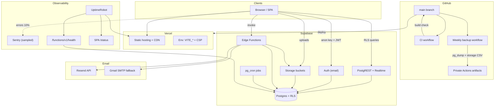
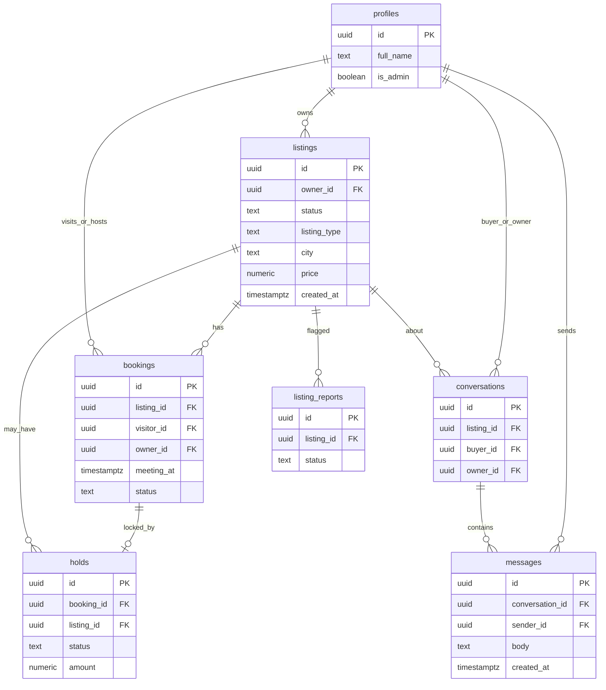

# Architecture — Haven & Co

How the production stack fits together, what data we store, and who can touch it.

## System diagram

## Runtime responsibilities

| Piece | Role |
| --- | --- |
| **Vercel** | Hosts the Vite SPA; env vars `VITE_SUPABASE_*`, `VITE_SENTRY_DSN`; `vercel.json` headers/CSP/rewrites. |
| **Supabase Auth** | Email signup/login; JWTs used by the client and Edge Functions. |
| **Postgres + RLS** | Source of truth for listings, bookings, holds, messages, reports, profiles, `app_events`. |
| **Storage** | Listing images (public URLs referenced from `listings.image_urls`). |
| **Edge Functions** | Privileged work: booking emails, message/listing notify, hold checkout/cancel, payment webhook, account delete, health. |
| **Resend / Gmail** | Transactional mail from Edge Functions (Resend primary; SMTP fallback when configured). |
| **Sentry** | Frontend error monitoring (sampled ~10%). |
| **GitHub** | Source of truth for code; CI on push/PR; weekly `DATABASE_URL` dump to a **private** artifact. |

## Data model (core)

Supporting tables: `app_events` (ops telemetry), Storage `objects`/`buckets` (image blobs).

Indexes for growth live in `supabase/migration_indexes.sql` (status/type/city/price/created_at, messages by conversation, bookings by listing/meeting).

## Permission model

Access is **RLS-first**. The browser only has the **anon** (publishable) key; it never holds the service role.

| Actor | Listings | Bookings / holds | Messages | Admin |
| --- | --- | --- | --- | --- |
| **Anonymous** | Read `approved` only | None | None | None |
| **Owner** | CRUD own rows; create → `pending` | See bookings on own listings; cancel holds as owner via Edge | Participant in owner-side chats | — |
| **Visitor / buyer** | Read approved; report | Create/cancel own bookings; pay hold via Edge | Participant in buyer-side chats | — |
| **Admin** (`profiles.is_admin`) | Approve/reject pending; see reports | Same as authenticated + review tools | Same as authenticated | Admin UI + report resolution |
| **Edge (service role)** | Bypass RLS for notify/health/delete/payment | Create/update holds, refunds | Read for email notify | N/A |

Hard rules:

1. **Never** put the service-role key in `VITE_*` or the SPA bundle.
2. Mutations that move money or send mail go through **Edge Functions** with server secrets (`RESEND_API_KEY`, SMTP, payment keys).
3. Realtime message inserts still pass RLS (`conversation` participant only).
4. Account deletion is an Edge Function so Auth + profile + storage can be cleaned with elevated rights.

## Request paths (typical)

1. **Browse** — SPA → PostgREST `listings` (approved + filters + `.range` pagination).
2. **Book** — SPA insert booking → Edge `send-booking-email` / hold checkout → Resend or SMTP.
3. **Message** — SPA insert `messages` → Realtime to peer → Edge `notify-new-message`.
4. **Admin review** — SPA update listing status (RLS admin) → optional notify Edge.
5. **Backup** — GitHub Action `pg_dump` with `DATABASE_URL` → private artifact (see RUNBOOK).
